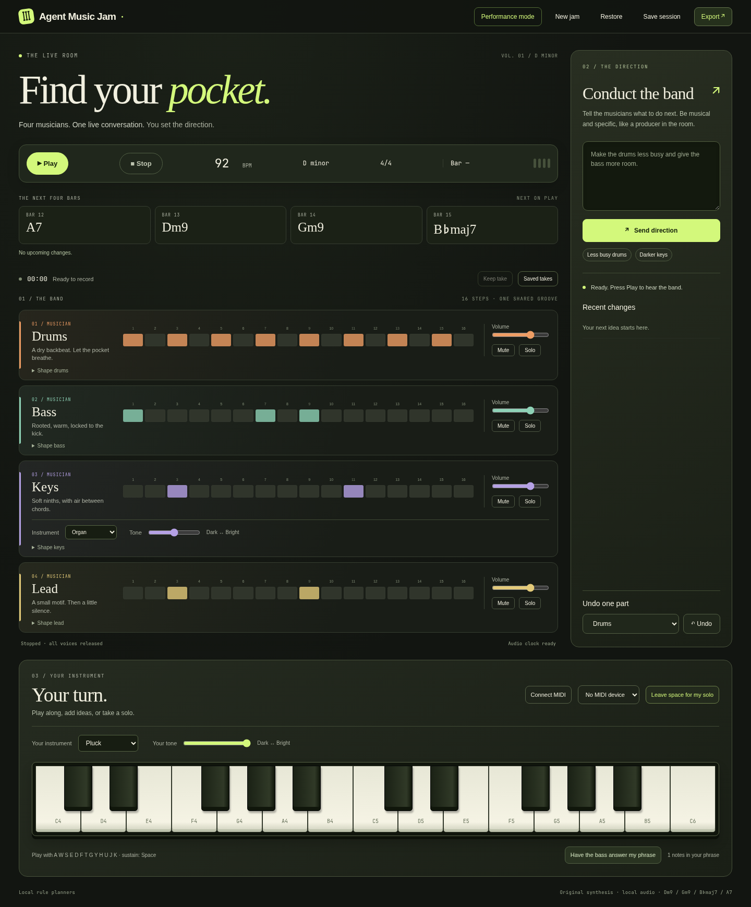

# Agent Music Jam

A band you can jam with: drums, bass, keys and lead, with a shared D-minor pocket and a natural-language conductor. Music keeps playing while the musicians plan their next change.



[Download release and performance demo](https://github.com/vdimarco/agent-music-jam/releases/tag/v0.1.1). The demo shows the earlier visual theme; the screenshot shows the current studio.

## Start locally

Python 3.11+ and a current Chromium-based browser are sufficient. No build, npm install, samples, CDN or Python packages are needed to run the plugin.

```sh
python run.py
```

Open the private loopback link printed in the terminal, then click **Play**. This standalone rehearsal uses explicitly labelled local rule planners. Try “Make the drums less busy”, “Make the keys darker”, “Give the drummer a fill”, or “Leave space for my solo”. Free-form model interpretation is available through Hermes.

The first version deliberately concentrates on one ensemble: **D minor, 4/4, Dm9 → Gm9 → B♭maj7 → A7**. Tempo is 40–200 BPM; change it before starting a fresh jam. The key and meter displays are fixed, not nonfunctional selectors.

## Install the native Hermes plugin

Requires Hermes **0.23.0 or newer**. Copy this source directory into `~/.hermes/plugins/agent-music-jam` (do not overwrite an existing installation without backing it up), then:

```sh
hermes plugins validate ~/.hermes/plugins/agent-music-jam --install-deps
hermes plugins enable agent-music-jam
```

Start a new Hermes session and ask: “Start Agent Music Jam.” Hermes calls `jam_start` and returns a private local browser link. Keep that Hermes session running while using the browser. Browser autoplay restrictions require a click on Play.

Registration declares ten tools and an unload callback. **It opens no sockets, starts no playback, and launches no background processes.** The local HTTP service and daemon threads begin only when `jam_start` is invoked. The service shuts down when the plugin unloads. No subprocess is launched by the plugin.

### Tools

| Tool | Purpose |
| --- | --- |
| `jam_start` | Start the local service and return its browser link |
| `jam_inspect` | Inspect intentions, jobs, confirmed activation bars and audio-clock heartbeat |
| `jam_stop` | Cancel queued work and tell the playback browser to release all voices |
| `jam_direct` | Asynchronously conduct with natural language |
| `jam_configure` | Change one role’s musical controls |
| `jam_schedule` | Delay a role’s controls/mute by 0–64 bars beyond the next available buffer boundary |
| `jam_undo` | Cancel pending changes or restore the previous state of one musician |
| `jam_save` | Save the complete session through `ctx.state` |
| `jam_restore` | Restore that saved session, stopped |
| `jam_export` | Request a MIDI or WAV download in the playing browser |

A typical `jam_configure` argument is `{"role":"bass","controls":{"density":0.25,"energy":0.5}}`. Density, energy, complexity, swing and variation range from 0 to 1. Register is a semitone offset from -12 to 12.

Plugin settings live under `plugins.entries.agent-music-jam.settings`:

```yaml
port: 0                 # Choose a free loopback port
use_subagents: true     # Tool-launched musician planning uses Hermes children
```

There are no plugin API keys. Conductor and browser musician calls use `ctx.llm.complete_structured` and the host’s configured model. Active-turn tool calls use `ctx.subagent_lifecycle` for musician child sessions when enabled. Browser requests have no active Hermes parent turn, so they use explicit stateful role planners instead. These are not misrepresented as autonomous Hermes child sessions. Model results are validated again before queuing. Failed or late results never replace the current pattern. Error messages expose error classes, not provider response bodies.

## Play and conduct

- **Mixer:** volume, mute and solo per musician. These apply immediately; musical composition changes wait for the next available bar.
- **Shape a musician:** density, energy, complexity, register, swing and variation. Other roles stay unchanged.
- **Change instrument:** use the instrument selector directly on the **Keys** track for the band’s keyboard sound. Under **Your turn**, choose your own instrument: Piano, Electric piano, Organ, Warm pad or Pluck.
- **Change tone:** the Dark ↔ Bright sliders alter the low-pass filter. Tone changes also affect existing voices; instrument choices affect newly created notes. The band may already have up to three bars scheduled with the previous instrument.
- **Play:** use the on-screen piano or computer keys `A W S E D F T G Y H U J K`. Space sustains. Keyboard shortcuts do not intercept text fields or focused buttons. Click an empty area before using computer keys.
- **MIDI:** click Connect MIDI, grant browser access and explicitly select a device. Note-off, velocity-zero note-on, sustain, all-notes-off and disconnect are handled. Sysex is not requested.
- **Respond:** play a phrase, then click “Have the bass answer my phrase.” The phrase is included in that musician’s planning context.
- **Leave space:** a four-bar solo arrangement thins the keys and silences the lead, then restores them.
- **Undo:** choose a musician. Uncommitted changes are cancelled; otherwise its previous pattern and controls return at the next available bar.

The recording contains only the app’s synthesized output. There is no microphone access or speech transcription.

## Performance mode, timeline and takes

**Performance mode** hides the introductory artwork and musician panels, keeping the same live transport, chord strip and keyboard within reach. Show band controls to adjust musicians; Studio view restores the full layout. Switching views never restarts audio.

The four-bar chord strip follows the actual browser audio clock. Upcoming changes display confirmed bar numbers from the allocated arrangement; plans still waiting for scheduling are labelled separately. Stopped playback previews the next four bars.

A recording timer displays captured audio duration. **Keep take** stops and flushes the recording, then saves WAV and MIDI together in IndexedDB. **Saved takes** downloads either format and lets you remove a take after confirmation. The shelf holds at most ten takes / 100 MB and never automatically deletes older recordings. A storage failure preserves the current audio so you can download it instead.

Browser storage belongs to the exact local address, including its port. It survives reloads at that address, but a different service port, browser, profile or cleared browser storage makes it unavailable. Download important recordings for a permanent backup. No take audio is uploaded to a third-party service; the local service creates the MIDI blob.

Play, New jam and Restore protect an unexported current recording with Keep and continue, Discard and continue, or Go back. A MIDI-only download does not mark the WAV as backed up. Leaving the page with an unprotected recording requests the browser’s standard leave-page warning; browsers may suppress that warning, particularly on mobile or forced termination.

## Timing and state

Python composes data; the browser schedules oscillators and envelopes at absolute `AudioContext.currentTime` values. A 100 ms scheduler maintains roughly two to three bars ahead. Model requests run separately from HTTP/audio work. Playback reuses the current four-bar pattern until a validated replacement arrives.

Plans first show **planning**, then **waiting for audio buffer**. The service assigns a numbered activation bar only when the browser requests that future bar. Heartbeats change **queued** to **playing** after the audio clock reaches it. A future arrangement can show several role/bar activations. The 16-step display follows actual scheduled event times and current mixer audibility; it does not fabricate activity from a timer.

Stop cancels pending composition and releases scheduled and sounding voices. The local Stop button releases immediately; a Hermes stop arrives through polling (normally within 700 ms). Browser suspension or a long main-thread stall can still exhaust the finite buffer; late-event counters expose recovery. This is not a hard real-time desktop audio driver.

## Save, restore and export

**Save session** downloads JSON, and also writes profile-scoped `ctx.state` when hosted by Hermes. It includes tempo, harmony, role controls, intentions, motifs, patterns, undo histories, pending arrangement, allocated performance bars, mixer and instrument/tone settings. **Restore** validates before replacing musical state and leaves playback stopped. Resumption starts at the next unallocated bar. Audio samples from an old browser take are not embedded in session JSON.

**MIDI:** standard format-1 SMF, 480 ticks per quarter, tempo/meter metadata, separate drums, bass, keys, lead and human tracks. Drums use channel 10. Browser exports omit notes scheduled after Stop, respect mute/solo at onset, and shorten notes when a part is muted. Velocity follows the mixer at note onset. Program changes approximate the currently selected synthesis instrument with General MIDI; MIDI does not reproduce the exact synthesizer, filter automation or compressor.

**WAV:** actual mono, 16-bit PCM browser output captured by an AudioWorklet at the device sample rate, including live keyboard notes, mixer actions and tone changes. WAV export stops and flushes the take before downloading. A new Play begins a new take. Export before restarting or closing the tab. WAV capture is capped at 15 minutes; musical sessions at 4096 allocated bars. These bounds keep local memory finite.

## Security and disclosures

- Binds only to `127.0.0.1`; checks Host, Origin and a random 256-bit bearer token on every API request. No CORS allowance. One active browser owns transport.
- The private launch link carries a token in its fragment, not an HTTP query. The browser removes the fragment and retains the token in session storage. Do not share that link. HTTP access logging is disabled.
- Model credentials stay inside Hermes. No credential files, environment secrets, browser profiles or external credential stores are read by this plugin.
- Music state and user directions/phrases are sent to the model configured by Hermes. No other network destination, analytics, telemetry or remote media is used.
- Reads its own source assets and user-selected session JSON. Persists its own profile-scoped state and user-kept WAV/MIDI takes in local browser IndexedDB; exports download through the browser. No shell commands, self-updater or compiled payload.
- Original procedural instruments; no third-party sample licensing required. Code is MIT.

## Verify and release

```sh
python -m unittest discover -s tests -v
hermes plugins doctor . --ci
hermes plugins validate . --install-deps
```

See [verification](docs/VERIFICATION.md), [architecture](docs/ARCHITECTURE.md), and [catalog preparation](docs/CATALOG.md). The supplied demo is an actual browser performance using local rule planners and automated on-screen keyboard input; it is not a claim of a physical MIDI-controller or live child-session test.
